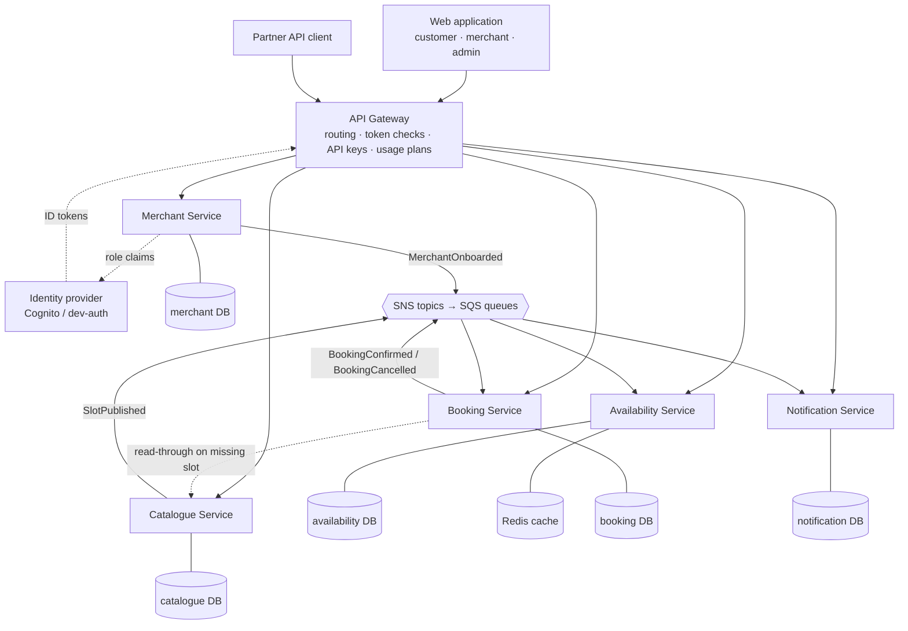
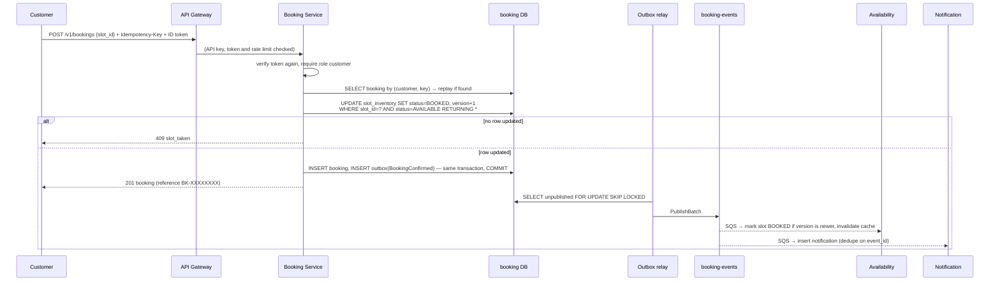
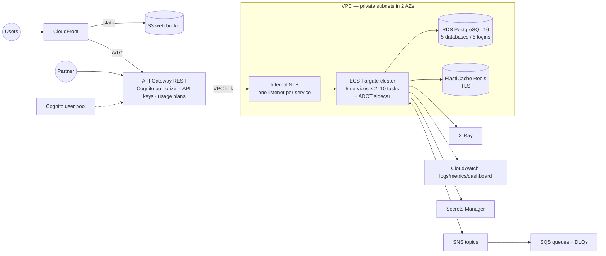

# Architecture

Organised along the project report template (sections 3–4) so it can be lifted into the report.

## 1. Logical architecture

| Service | Owns (data) | Publishes | Consumes |
|---|---|---|---|
| Merchant | Merchant, Membership | MerchantOnboarded | – |
| Catalogue | Resource, TimeSlot | SlotPublished | – |
| Availability | MerchantView, SlotView (read model) | – | all four events |
| Booking | SlotInventory, Booking, Outbox | BookingConfirmed, BookingCancelled | SlotPublished |
| Notification | Notification, ProcessedEvent | – | BookingConfirmed, BookingCancelled |

### Domain-driven design

Bounded contexts map one-to-one to services. Aggregates and their invariants:

- **Merchant** (root) with **Membership**: a user belongs to at most one merchant (the merchant ID
  travels as a single token claim). Enforced by a unique index.
- **Resource** with **TimeSlot**: slots of one resource never overlap. Enforced in the database —
  every slot starts on a whole hour and lasts one hour, and `(resource_id, start_time)` is unique.
- **SlotInventory** with **Booking** (Booking context): at most one active booking per slot; a
  booking moves only `CONFIRMED → CANCELLED`, only before the slot starts, only by its owner.
- Domain events (`contracts/events/*.schema.json`) are the only coupling between contexts. Each
  carries the full slot snapshot and a monotonically increasing `slot_version`.

Producers (merchants) interact through the Merchant/Catalogue APIs and onboarding files;
consumers (customers, partners) through Availability/Booking/Notification APIs. Neither side
knows about the other's services.

### Detailed design: create booking

Concurrent requests serialise on the slot row; under READ COMMITTED the losers' `UPDATE` re-checks
`status = 'AVAILABLE'`, matches nothing and returns 409. A partial unique index
(`bookings(slot_id) WHERE status = 'CONFIRMED'`) is the last line of defence. Tested with 50
threads in `services/booking/tests` and 100 HTTP requests in `tests/concurrency/same_slot.py`.

### Key architectural decisions (logical)

| ID | Decision | Rationale and trade-off |
|---|---|---|
| AD-01 | Five microservices split by business capability **and** load profile | Search is ~80% of traffic and must scale apart from booking; booking holds the strictest rules so all of its consistency logic stays in one service. Cost: more deployables, mitigated by the service template and shared Terraform module. |
| AD-02 | Database per service, no cross-service table access | Services evolve and scale independently; cost: data is replicated via events and is eventually consistent. |
| AD-03 | Search is a CQRS read model built from events | Searches never touch the Booking Service's tables; results may lag a few seconds, so the Booking Service remains the authority and returns 409 on a stale pick. |
| AD-04 | Booking decided by one local transaction (conditional UPDATE + unique index), no distributed transaction | Correct under concurrency with no 2PC; a saga with cancellation as compensation is the documented path if payment is added. |
| AD-05 | Transactional outbox + idempotent consumers (`processed_events`) | An event is published iff its change committed; at-least-once delivery is made effectively-once by de-duplicating on `event_id`. |
| AD-06 | Events carry full snapshots and a `slot_version` | Consumers converge regardless of delivery order across queues (tested: confirm/cancel arriving before SlotPublished). |
| AD-07 | Merchant ID and role travel as token claims written by the Merchant Service into the IdP | No per-request call to the Merchant Service; cost: a user must sign in again after a role change. |
| AD-08 | Every service verifies tokens itself (defence in depth) | A misrouted or internal call cannot bypass authorisation. |
| AD-09 | Shared service template (`platform_common`) instead of a service mesh | Timeouts, retries, circuit breaker, tracing, outbox and health checks are uniform with less operational weight than a mesh. |
| AD-10 | Idempotency keys on booking creation | Client retries (timeouts, double-clicks, partner retries) never create a second booking. |

## 2. Physical architecture (AWS, `infra/terraform`)

| ID | Decision | Rationale and trade-off |
|---|---|---|
| AD-11 | ECS on Fargate, one ECS service + task definition per microservice, min 2 tasks | No servers to manage, per-service auto scaling and rolling deploys; Fargate costs more per vCPU than EC2 but removes capacity management. |
| AD-12 | 0.25 vCPU / 512 MB tasks | A single task saturates within the test budget, making the effect of scale-out visible. |
| AD-13 | Target tracking on CPU for HTTP services; backlog-per-task (SQS visible ÷ running tasks) for Notification | Each service scales on its own load signal. |
| AD-14 | REST API Gateway (not HTTP API) → VPC link → internal NLB | REST API supports API keys and usage plans per client application and the Cognito authorizer; the NLB is what REST VPC links require. |
| AD-15 | One RDS instance, one database and login per service | Keeps cost down for the test environment; any database can move to its own instance by changing its secret only. The shared instance is the expected bottleneck and is monitored. |
| AD-16 | CloudFront serves the SPA and forwards `/v1/*` to API Gateway | Single origin for the browser: no CORS, one TLS endpoint, security headers policy. |
| AD-17 | ECS Service Connect for the only direct call (Booking → Catalogue read-through) | Service discovery without a mesh; the call is protected by timeout/retry/circuit breaker. |
| AD-18 | Deployment circuit breaker with rollback | A version whose tasks never pass health checks is rolled back automatically. |
| AD-19 | GitHub OIDC deploy role | No long-lived AWS keys in CI. |

### Persistence and information architecture

| Data group | Format / store | Security controls | Trade-off |
|---|---|---|---|
| Merchants, memberships | Rows in `merchant` DB (PostgreSQL) | Own login, TLS, encryption at rest, admin-only writes | Relational integrity over flexibility |
| Resources, time slots | Rows in `catalogue` DB | Own login; DB constraints prevent overlaps | Fixed one-hour slots keep the invariant simple |
| Slot inventory, bookings, outbox | Rows in `booking` DB | Own login; partial unique index; customer-scoped queries | Strong consistency where it matters |
| Availability read model | Rows in `availability` DB + JSON in Redis (TTL 30 s, generation keys) | No personal data in the read model; Redis TLS, SG only from Availability | Eventual consistency for cheap, scalable reads |
| Notifications | Rows in `notification` DB | Customer-scoped; contains booking reference only | – |
| Events | JSON envelopes in SNS/SQS (SSE), 4-day retention, DLQ 14 days | Topic → queue policies scoped by source ARN; IAM per service | At-least-once, de-duplicated by consumers |
| Identities | Cognito user pool | Admin-created users, password policy, merchant claim not user-writable | – |
| Secrets | Secrets Manager (DB URLs, RDS master) | Read only by the owning task's execution role | – |

## 3. Quality attributes

**Performance** — Read model + Redis cache for searches (cache hits served as pre-serialised
JSON), paging (default 200, max 1,000), indexed search `(local_date, resource_type, merchant_id,
start_time)`, connection pool per task, short transactions in Booking.

**Scalability** — Stateless services, per-service auto scaling, search and booking scale
independently, outbox relays and consumers safe in every task (`SKIP LOCKED`, idempotency).

**Availability** — ≥2 tasks per service across 2 AZs, health checks, ECS replaces failed tasks,
event-driven decoupling (booking works with Notification or Availability down), retries + DLQs,
circuit breakers on Redis and the Catalogue read-through, zero-downtime rolling deploys with
automatic rollback.

**Security** — Cognito ID tokens checked at the gateway **and** in every service; roles
(`platform_admin`, `merchant_admin`, `merchant_staff`, `customer`) plus server-side merchant
membership and ownership checks; API keys + usage plans + throttling; HTTPS; input validation
(Pydantic); a DB login per service; encryption at rest (RDS, Redis, SQS, SNS, S3); Secrets
Manager; least-privilege task roles; security groups per service; VPC flow logs; SAST, secret
scanning, dependency and image scanning, ZAP baseline in every pipeline.

**Extensibility and maintainability** — New merchants by configuration (`merchants/*.yaml`); new
clients by API key + usage plan; new services from the template + `modules/ecs-service`;
versioned OpenAPI and event contracts checked by contract tests.

## 4. Architectural limitations

| ID | Issue and impact | Resolution / roadmap |
|---|---|---|
| AISS-01 | Single shared RDS instance is the scaling ceiling and a single point of failure (no Multi-AZ in test) | Move the Booking DB to its own Multi-AZ instance first; add read replicas for Availability |
| AISS-02 | A user can belong to only one merchant | Move from a single claim to a list claim or a token-exchange step |
| AISS-03 | Role changes take effect at the next sign-in | Shorter ID token lifetime or Cognito pre-token-generation trigger |
| AISS-04 | Fixed one-hour, capacity-one slots | Variable duration via `EXCLUDE USING gist` constraint; capacity via counters on the inventory row |
| AISS-05 | No payment | Booking becomes a saga with cancellation as the compensating step |
| AISS-06 | Single NAT gateway in test | One per AZ in production |
| AISS-07 | Local SQS emulator (moto) is slow for large backlogs | Local only; seed smaller datasets locally, full dataset in AWS |
