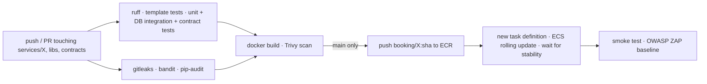

# Deployment and operations

## Environments

| Environment | How | Purpose |
|---|---|---|
| local | `docker compose up` or `scripts/dev_native.py up` | development, demos without cloud cost |
| test (AWS) | `infra/terraform/envs/test` + GitHub Actions | scalability, recovery and security tests; presentation |

## First deployment to AWS

Prerequisites: AWS CLI with admin credentials for the account, Terraform ≥ 1.6, Docker.

1. **State backend** — `./scripts/aws_bootstrap.sh state`, then copy
   `infra/terraform/envs/test/backend.hcl.example` to `backend.hcl` with the bucket name.
2. **Infrastructure** — copy `test.tfvars.example` to `test.tfvars`, then
   ```bash
   terraform -chdir=infra/terraform/envs/test init -backend-config=backend.hcl
   ```
   ```bash
   terraform -chdir=infra/terraform/envs/test apply -var-file=test.tfvars
   ```
   ECS services start once their first image exists (next step).
3. **First images** — `./scripts/aws_bootstrap.sh images` (pushes tag `bootstrap`).
4. **Databases** — `./scripts/aws_bootstrap.sh database` runs the one-off ECS task that creates
   one database and login per service, then force a new deployment of the services.
5. **Users** — `DEMO_PASSWORD=... ./scripts/aws_bootstrap.sh users`.
6. **GitHub** — repository variables: `AWS_REGION`, `AWS_DEPLOY_ROLE_ARN`, `ECS_CLUSTER`,
   `WEB_URL`, `WEB_BUCKET`, `CLOUDFRONT_DISTRIBUTION_ID`, `COGNITO_WEB_CLIENT_ID`,
   `SMOKE_USER_A`, `SMOKE_USER_B`; secrets: `WEB_API_KEY`, `SMOKE_API_KEY`, `SMOKE_PASSWORD`
   (all values come from `terraform output`). Protect the `test` environment with required reviewers
   if promotions should be approved.
7. **Onboard merchants** —
   ```bash
   PLATFORM_GATEWAY=<web_url> PLATFORM_API_KEY=<web key> COGNITO_CLIENT_ID=<web client> python scripts/onboard_merchant.py merchants/city-courts.yaml
   ```

## Pipeline (per service)



- Path filters: only the changed service's pipeline runs; a change to `libs/` or `contracts/`
  runs all five.
- Images are immutable and tagged with the commit SHA.
- Pull requests run test, security and build (no push, no deploy).

## Rollback

Automatic: the ECS deployment circuit breaker rolls back a deployment whose tasks fail health checks.

Manual (to any earlier revision):

```bash
aws ecs list-task-definitions --family-prefix test-booking --sort DESC --max-items 5
```

```bash
aws ecs update-service --cluster booking-test --service booking --task-definition test-booking:<revision>
```

## Cost control

Set every service to zero tasks when not testing:

```bash
for s in merchant catalogue availability booking notification; do aws ecs update-service --cluster booking-test --service $s --desired-count 0 >/dev/null; done
```

(also set the auto scaling minimum to 0, or `terraform apply -var 'service_scaling={...min=0...}'`).
`terraform destroy` removes everything except the state bucket.

## Operations

- Dashboard: `terraform output dashboard_url` — tasks per service, CPU, API latency/errors, queue
  depth, RDS and cache.
- Alarms: any message in a DLQ; API 5xx rate > 1%.
- Logs: CloudWatch `/ecs/test-<service>` (JSON, with `trace_id` for correlation with X-Ray).
- Dead-lettered events: inspect in the SQS console, fix, then redrive to the source queue
  ("Start DLQ redrive"); consumers are idempotent so redrives are safe.
