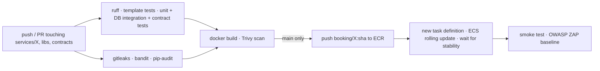

# Deployment and operations

## Environments

| Environment | How | Purpose |
|---|---|---|
| local | `docker compose up` or `scripts/dev_native.py up` | development, demos without cloud cost |
| test (AWS) | `infra/terraform/envs/test` + GitHub Actions | scalability, recovery and security tests; presentation |

## First deployment to AWS

Prerequisites: AWS CLI configured with credentials for the target account (`aws configure`),
Terraform >= 1.6, Python venv with `boto3`, Node.js. Docker is **not** needed locally: images are
built in AWS CodeBuild (`infra/terraform/envs/test/build.tf`).

```bash
DEMO_PASSWORD='<8+ chars, upper, lower, digit>' python scripts/aws_deploy.py all
```

`all` runs these steps, each of which can also be run on its own:

| Step | What it does |
|---|---|
| `state` | S3 state bucket + DynamoDB lock table, writes `backend.hcl`, `terraform init` |
| `base` | network, RDS, ECR, secrets, CodeBuild and the bootstrap task (no services yet) |
| `images` | zips the source, CodeBuild builds and pushes the five images tagged with the commit |
| `database` | one-off ECS task: one database and login per service |
| `infra` | full `terraform apply`; waits until every ECS service is stable |
| `users` | demo users in Cognito with `DEMO_PASSWORD` |
| `web` | builds the web app, writes `config.json` (API key, Cognito client), publishes to S3 + CloudFront |
| `env` | writes `.local/aws.env` (URLs, API keys) for the test scripts |

Then onboard merchants against the cloud gateway (values from `.local/aws.env`):

```bash
python scripts/onboard_merchant.py merchants/city-courts.yaml
```

For GitHub Actions, set the repository variables `AWS_REGION`, `AWS_DEPLOY_ROLE_ARN`,
`ECS_CLUSTER`, `WEB_URL`, `WEB_BUCKET`, `CLOUDFRONT_DISTRIBUTION_ID`, `COGNITO_WEB_CLIENT_ID`,
`SMOKE_USER_A`, `SMOKE_USER_B` and the secrets `WEB_API_KEY`, `SMOKE_API_KEY`, `SMOKE_PASSWORD`
(values from `terraform output` and `.local/aws.env`).

Roll out the current commit to one service without GitHub:

```bash
python scripts/aws_deploy.py release booking
```

## Pipeline (per service)



- Path filters: only the changed service's pipeline runs; a change to `libs/` or `contracts/`
  runs all five.
- Images are immutable and tagged with the commit SHA.
- Pull requests run test, security and build (no push, no deploy).

## Rollback

Automatic: the ECS deployment circuit breaker rolls back a deployment whose tasks fail health checks.

Manual (to any earlier revision):

```bash
aws ecs list-task-definitions --family-prefix test-booking --sort DESC --max-items 5
```

```bash
aws ecs update-service --cluster booking-test --service booking --task-definition test-booking:<revision>
```

## Cost control

Stop every service when not testing (sets the auto scaling limits too), and resume later:

```bash
python scripts/aws_deploy.py scale --tasks 0
```

```bash
python scripts/aws_deploy.py scale --tasks 2
```

RDS, Redis, the NAT gateway and the NLB keep billing while stopped (about 0.25 USD/hour).
`terraform destroy` removes everything except the state bucket.

## Operations

- Dashboard: `terraform output dashboard_url` — tasks per service, CPU, API latency/errors, queue
  depth, RDS and cache.
- Alarms: any message in a DLQ; API 5xx rate > 1%.
- Logs: CloudWatch `/ecs/test-<service>` (JSON, with `trace_id` for correlation with X-Ray).
- Dead-lettered events: inspect in the SQS console, fix, then redrive to the source queue
  ("Start DLQ redrive"); consumers are idempotent so redrives are safe.
